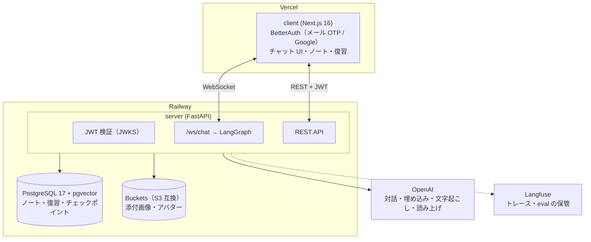

# Curigor

> 学んだことを AI に説明すると、AI の問い返しで分かっていない所が見つかる学習アプリ。対話からノートと復習の日程を作る。

**本番: [curigor.com](https://www.curigor.com)**（メールアドレスか Google アカウントで登録できます）

<!-- TODO: デモ GIF（説明する → 問い返し → ノートと次の復習日まで 15〜20 秒） -->
<!--  -->

[](https://github.com/R-koma/curigor/actions/workflows/ci.yml)


## できること

- **説明して学ぶ**: 学んだことを AI に説明すると、AI が抜けや誤りを問い返す。終わるとノートとフィードバックができる
- **教わって理解する**: 知らないことを疑問から教わり、観点・用語・要約を学習メモに残す
- **復習**: 間隔を空けた日程で、ノートを見ずに説明し直す。説明の結果でノートと次の復習日が変わる
- **まとめノート**: 関連するノートを束ね、ノート同士のつながりを候補として示す
- **声で話す**: 話して説明し、応答を読み上げで聞ける。画像の添付・数式・コードにも対応

## 個人開発の範囲

企画・設計・実装・テスト・インフラ・運用・法令対応（利用規約・プライバシーポリシー・アカウント削除）を 1 人で行っている。本番は Vercel（client）と Railway（server・DB・ストレージ）。

## 設計で判断したこと

| ADR | 課題 | 決めたこと |
| --- | --- | --- |
| [006](docs/adr/006-langfuse-eval-boundary.md) | LLM の応答の良し悪しを何で判定するか | Langfuse は保管と閲覧だけに使い、判定の基準（golden・criterion）と judge はコードと YAML で持つ |
| [018](docs/adr/018-daily-llm-limits.md) | LLM の費用を利用者ごとに抑える | 操作ごとの 1 日の回数を Postgres で数える。記録は LLM を呼ぶ前に行い、失敗や切断でも返さない（返すと上限を抜けられる） |
| [017](docs/adr/017-error-codes-and-protocol-version.md) | デプロイ後に古いタブが新しい server と話す | エラーに機械が読む `code` を持たせ、WebSocket の接続時に版を確かめて、合わなければ入力中の文を残して読み直す。REST の URL に版は付けない |
| [016](docs/adr/016-account-deletion-and-retention.md) | アカウント削除で消すべきデータが外部にもある | 削除専用の JWT で server を呼び、チェックポイント・画像・Langfuse の trace まで消す。論理削除はしない |
| [010](docs/adr/010-voice-conversation.md) | 声で話すときの送信と割り込み | 沈黙ではなく末尾の「以上」で送る。読み上げは PCM をストリーミングし、話し始めたら止める |

ほかの判断は [docs/adr/](docs/adr/)（20 本）。

## 品質の仕組み

- **LLM の応答の eval**: 説明への問い返しの失敗パターン 17 種を golden にし、LLM judge で回帰を確かめる。judge 自体も人間のラベルとの一致で測る（[server/evals/](server/evals/README.md)）
- **テスト**: server の unit テストは実 PostgreSQL に接続し（DB のモックは使わない）、カバレッジが 75% を下回ると CI を落とす。他人のリソースに届かないことを REST・WebSocket の両方でテストする
- **CI**: ruff・mypy（strict）・pytest・ESLint・`tsc`・`next build`・Vitest・Gitleaks を PR ごとに通す。CodeQL と Trivy（本番のイメージ）で脆弱性を調べ、依存は Dependabot で毎週更新する

---

## 目次

- [概要](#概要)
- [アーキテクチャ](#アーキテクチャ)
- [技術スタック](#技術スタック)
- [LangGraph フロー](#langgraph-フロー)
- [セットアップ](#セットアップ)
- [開発](#開発)
- [テスト](#テスト)
- [ディレクトリ構造](#ディレクトリ構造)
- [ドキュメント](#ドキュメント)

---

## 概要

インプットした知識を「自分の言葉で説明する（アウトプットする）」機会の不足によって、記憶が揮発してしまう課題を解決するための学習定着アプリケーションです。

「プロテジェ効果（人に教えることで学ぶ）」を LLM との対話にしています。ユーザーが学んだことを説明すると、LLM が深掘りの質問を返します。それに自分の頭で思い出して答えることで、知識を整理し、記憶に残りやすくします。

---

## アーキテクチャ



## 技術スタック

### フロントエンド

| カテゴリ | 技術 | 用途 |
|----------|------|------|
| フレームワーク | Next.js 16 (App Router) + React 19 | SSR/RSC 対応のフルスタックフレームワーク |
| 言語 | TypeScript (strict) | 型安全なフロントエンド開発 |
| 認証 | BetterAuth | メール OTP・Google ログイン / セッション管理 |
| WebSocket | カスタム Hook (`use-chat-websocket`) | サーバーとの双方向リアルタイム通信 |
| UI | shadcn/ui + Tailwind CSS | コンポーネントライブラリ |
| Markdown | react-markdown | LLM 応答のレンダリング |

### バックエンド

| カテゴリ | 技術 | 用途 |
|----------|------|------|
| 言語 | Python 3.13 | - |
| Web フレームワーク | FastAPI + Uvicorn | WebSocket / REST エンドポイント |
| LLM オーケストレーション | LangGraph + LangChain | 学習フローの状態管理・ルーティング |
| LLM | OpenAI（`server/graph/llm.py` でタスクごとに選ぶ） | 対話・ノート生成・フィードバック |
| 音声・埋め込み | OpenAI の文字起こし・読み上げ・埋め込み | 声で話す・ノートのつながりの候補 |
| ストレージ | S3 互換（aiobotocore） | 添付画像・アバター |
| 観測・eval | Langfuse + 自前の eval（`server/evals/`） | トレース・応答の回帰の確認 |
| 認証検証 | PyJWT + JWKS | BetterAuth 発行 JWT の公開鍵検証 |
| パッケージ管理 | uv | 依存関係管理 |

### データベース

| カテゴリ | 技術 | 用途 |
|----------|------|------|
| RDBMS | PostgreSQL 17 + pgvector | 全データの永続化・ノートの埋め込みの近傍検索 |
| データアクセス | asyncpg + 生 SQL | SQL ファーストアプローチ（ORM 不使用）|
| チェックポイント | langgraph-checkpoint-postgres | LangGraph フロー状態の永続化 |
| マイグレーション | Alembic | スキーマバージョン管理 |

## LangGraph フロー

```
route_entry（session_type で入口を分ける）
  ├─ "learning"  → learning_start  → learning_dialogue（ループ） → generate_note → generate_feedback → END
  ├─ "review"    → review_start    → review_dialogue（ループ）   → update_note_and_feedback → END
  ├─ "synthesis" → synthesis_start → synthesis_dialogue（ループ）→ finish_synthesis → END
  └─ "explore"   → explore_start   → explore_dialogue（ループ）  → generate_study_memo → END
```

- **learning**: 説明して学ぶ。対話の後にノートとフィードバック（理解度・良かった点・改善点）を作る
- **review**: 復習。ノートを見ずに説明し直し、ノートとフィードバックを更新する
- **synthesis**: まとめノートに束ねたノートを横断してまとめる
- **explore**: 教わって理解する。対話から学習メモを作る

> 技術選定の背景・比較検討・トレードオフは [docs/adr/](docs/adr/) を参照。

---

## セットアップ

### 前提条件

- Docker / Docker Compose
- Node.js 24+
- Python 3.13+
- [uv](https://docs.astral.sh/uv/)

### 初回セットアップ

```bash
# 1. リポジトリをクローン
git clone <repo-url>
cd curigor

# 2. 環境変数を設定
cp .env.example .env                      # POSTGRES_PASSWORD 等を記入（未設定だと docker compose が起動しない）
cp server/.env.example server/.env        # OPENAI_API_KEY 等を記入
cp client/.env.example  client/.env.local # BETTER_AUTH_SECRET 等を記入

# 3. 依存関係のインストール・DB 構築・マイグレーションを一括実行
make setup
```

`make setup` は server の `uv sync`、開発用 DB の起動、BetterAuth テーブル作成、Alembic マイグレーション、pre-commit フックの導入、client の `npm install` までを実行します。

### 開発サーバーの起動

```bash
make dev-db      # DB（初回のみ or 停止後）
make dev-server  # バックエンド（別ターミナル）
make dev-client  # フロントエンド（別ターミナル）
```

| 用途 | URL |
|------|-----|
| フロントエンド | http://localhost:3000 |
| API ドキュメント (Swagger) | http://localhost:8000/docs |
| ヘルスチェック | http://localhost:8000/api/health |

---

## 開発

### よく使うコマンド

| 目的 | コマンド |
|------|---------|
| Lint + フォーマット (server) | `cd server && uv run ruff check . --fix && uv run ruff format .` |
| 型チェック (server, strict) | `cd server && uv run mypy .` |
| Lint + 型チェック (client) | `cd client && npm run lint && npx tsc --noEmit` |
| マイグレーション生成 | `cd server && uv run alembic revision --autogenerate -m "description"` |
| マイグレーション適用 | `cd server && uv run alembic upgrade head` |
| ADR 雛形生成 | `make adr name=your-title` |

### コード規約

- **Python**: Ruff + mypy strict（行長 119 / Python 3.13 / ルール E,W,F,I,B,UP）
- **TypeScript**: ESLint + Prettier（strict モード）
- **pre-commit**: コミット時に ruff（server）/ mypy（server）/ prettier（client）が自動実行（`uv run pre-commit install`）

> **マイグレーション順序の注意**: `alembic upgrade head` の前に `client/better-auth_migrations/*.sql` を適用する必要があります（外部キー制約）。`make setup` はこの順序を自動で行います。

> **BetterAuth スキーマの再生成**: `client/better-auth_migrations/*.sql` は静的スナップショットで、`client/lib/auth.ts` のプラグイン構成とは自動同期しません。プラグインを追加・変更したとき（例: `jwt()` は `jwks` テーブルを要求）は再生成してコミットしてください。漏れると新環境のセットアップ時に `relation "jwks"/"user" does not exist` で認証が失敗します。

クライアント側のマイグレーションコマンドは 2 つあり、役割が異なります。

| コマンド | 動作 |
|----------|------|
| `cd client && npx @better-auth/cli generate --config lib/auth.ts` | 現在のプラグイン構成に対応する**フルスキーマ SQL を新しいファイル名で出力**する。DB には一切触れない |
| `cd client && npx @better-auth/cli migrate --config lib/auth.ts` | `client/.env.local` の `DATABASE_URL` が指す DB へ**直接 DDL を適用**する。ファイルは残らない |

`generate` は認証モジュールの `import "server-only"` で読み込みに失敗するので、実行の間だけその行を外すか差し替えてください。

リポジトリの正規手順は `generate` で SQL を出してコミットし、DB への適用は `make setup`（psql 経由）に任せる方です。`migrate` は接続先が `client/.env.local` 依存なので、意図しない DB へ適用しないか確認してから使ってください。

> **スナップショットは常に 1 ファイルだけ**: `generate` が出力するのは差分ではなくフルスキーマです。再生成したら**古いファイルを削除**して、`client/better-auth_migrations/` には最新の 1 ファイルのみを置いてください。複数残すと `make setup` が古い方を先に適用し、新しい方は全文 `already exists` で失敗します。

### トラブルシューティング

| 症状 | 原因 | 対処 |
|------|------|------|
| `relation "user" does not exist`（`alembic upgrade head` 時） | BetterAuth の認証SQL未適用 | `client/better-auth_migrations/*.sql` を先に適用（`make setup` が自動実行） |
| `relation "jwks" does not exist` など、認証・JWT 発行時のスキーマ不整合 | コミット済みスナップショットが `client/lib/auth.ts` のプラグイン構成より古い | `cd client && npx @better-auth/cli generate --config lib/auth.ts` で再生成し、古いスナップショットを削除して 1 ファイルにしてコミット。開発 DB は `docker compose down -v` → `make setup` で作り直す |
| `role "..." does not exist`（psql/接続時） | `.env` の `POSTGRES_USER` と接続先ユーザーの不一致 | DBコンテナの実値（`docker compose exec db printenv POSTGRES_USER`）に合わせる |
| `relation "user" already exists`（`make setup` 時） | 認証SQLのスナップショットが複数ある、または適用済みの DB に再実行した | `client/better-auth_migrations/` を最新 1 ファイルに整理する。作り直す場合は `docker compose down -v` でボリュームごと削除してから `make setup` |

---

## テスト

| 種別 | 場所 | フレームワーク | カバレッジ目標 |
|------|------|--------------|--------------|
| バックエンド unit | `server/tests/unit/` | pytest | 75%（下回ると CI が落ちる） |
| バックエンド integration | `server/tests/integration/` | pytest | - |
| フロントエンド | `client/__tests__/` | Vitest | - |

```bash
make test-db                                   # テスト用 DB 起動（初回のみ）
cd server && uv run pytest --cov=. --cov-report=term
cd client && npm run test
```

- DB を使うテストは実 PostgreSQL に接続します（**モック禁止**）
- `asyncio_mode = "auto"` のため `@pytest.mark.asyncio` は不要

### CI（GitHub Actions）

`main` への push / PR で以下が必須通過です。

`server-lint` ・ `server-typecheck` ・ `server-test` ・ `client-lint` ・ `client-test` ・ `secret-scan`（Gitleaks）

ほかに CodeQL（`codeql.yml`）と Trivy（`trivy.yml`。本番の server のイメージ）が脆弱性を調べ、結果は Security タブに出ます。LLM の応答の eval は課金があるため CI では走らせず、手で実行します（[server/evals/](server/evals/README.md)）。

---

## ディレクトリ構造

```
.
├── client/                    # Next.js フロントエンド
│   ├── app/
│   │   ├── (auth)/            # sign-in, sign-up, consent
│   │   └── (main)/            # dashboard, learn, notes, review, study-memos, settings
│   ├── components/
│   │   ├── chat/              # チャット UI
│   │   ├── layout/            # sidebar, navbar
│   │   └── ui/                # shadcn/ui コンポーネント
│   ├── hooks/
│   │   └── use-chat-websocket.ts  # WebSocket ライフサイクル管理
│   ├── lib/
│   │   ├── api.ts             # fetchAPI()（JWT 自動付与）
│   │   └── auth.ts / auth-client.ts
│   └── __tests__/             # Vitest テスト
│
├── server/                    # FastAPI バックエンド
│   ├── main.py                # エントリーポイント・lifespan
│   ├── api/
│   │   ├── routes/            # REST: ノート・復習・まとめノート・学習メモ・音声・アカウントなど
│   │   ├── websocket/chat.py  # WebSocket (/ws/chat)
│   │   └── dependencies.py    # CurrentUser, DB
│   ├── core/                  # auth, config, database
│   ├── graph/                 # LangGraph: builder, state, nodes, prompts
│   ├── repositories/          # SQL-first データアクセス
│   ├── storage/               # 添付画像・アバターの保存先（local / S3 互換）
│   ├── speech/ transcription/ embedding/  # OpenAI の音声・埋め込み
│   ├── observability/         # Langfuse へのトレース
│   ├── evals/                 # LLM の応答の eval
│   ├── schemas/               # Pydantic モデル
│   ├── services/              # review_scheduler など
│   └── tests/unit/ & integration/
│
├── docs/adr/                  # アーキテクチャ決定記録
├── docker-compose.yml
└── Makefile
```

---

## ドキュメント

- [CLAUDE.md](CLAUDE.md) — 開発者・AI エージェント向けのプロジェクト詳細ガイド
- [docs/adr/](docs/adr/) — アーキテクチャ決定記録（技術選定の背景）
</content>
</invoke>
